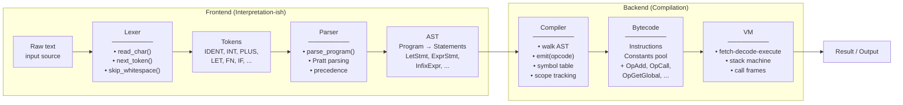
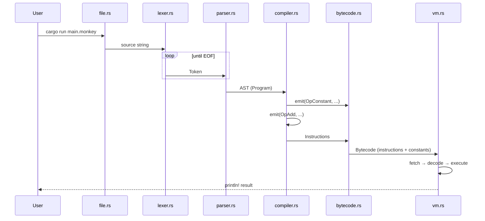
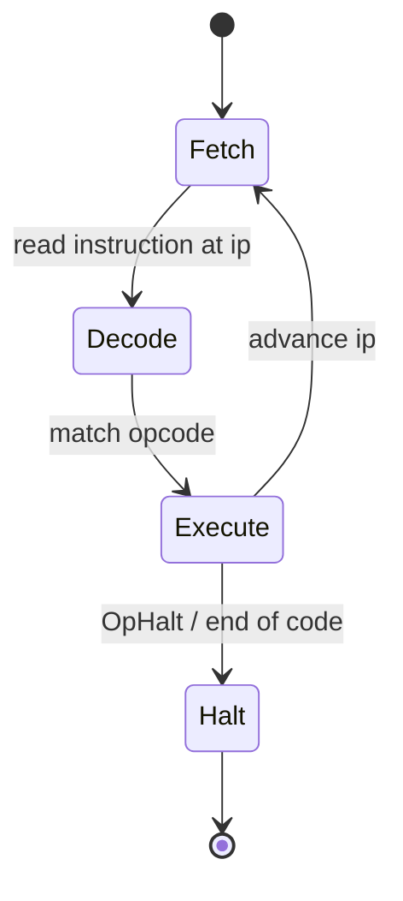

# Monkey Lang

A Monkey programming language implementation written in Rust.

## Installation

```bash
cargo install monkeyc
```

```mermaid
flowchart TD
    A["Source Code<br/>(main.monkey)"] --> B["Lexer<br/>lexer.rs"]
    B -->|"Token stream"| C["Parser<br/>parser.rs"]
    C -->|"AST (Program)"| D["Compiler<br/>compiler.rs"]
    D -->|"Bytecode<br/>bytecode.rs"| E["Virtual Machine<br/>vm.rs"]
    E -->|"Result"| F["Output"]

    G["Token definitions<br/>token.rs"] -.-> B
    G -.-> C
    H["REPL<br/>repl.rs"] --> B
    I["File loader<br/>file.rs"] --> B

    style A fill:#00000F
    style F fill:#d4edda
    style E fill:#1113cd
    style D fill:#f8d7da
    style C fill:#e2d5f1
    style B fill:#d1ecf1
```



# Stage-By-Stage Details



# Data Flow (Objects Passed Between Stages)



# Module Map

```mermaid
graph TD
    MAIN["main.rs<br/>(entry point)"]

    MAIN --> FILE["file.rs<br/>read source file"]
    MAIN --> REPL["repl.rs<br/>interactive mode"]

    FILE --> LEX["lexer.rs"]
    REPL --> LEX

    LEX --> TOKEN["token.rs<br/>token types"]
    LEX --> PARSER["parser.rs"]

    PARSER --> ASTNODE["AST nodes<br/>(in parser.rs)"]
    PARSER --> COMPILER["compiler.rs"]

    COMPILER --> BYTECODE["bytecode.rs<br/>opcodes + Instructions"]
    COMPILER --> VM["vm.rs"]

    VM --> OUT["Output"]

    style MAIN fill:#111111
    style VM fill:#bbbbbb
    style OUT fill:#111111
```



# Instruction Cycle (VM Internals)


